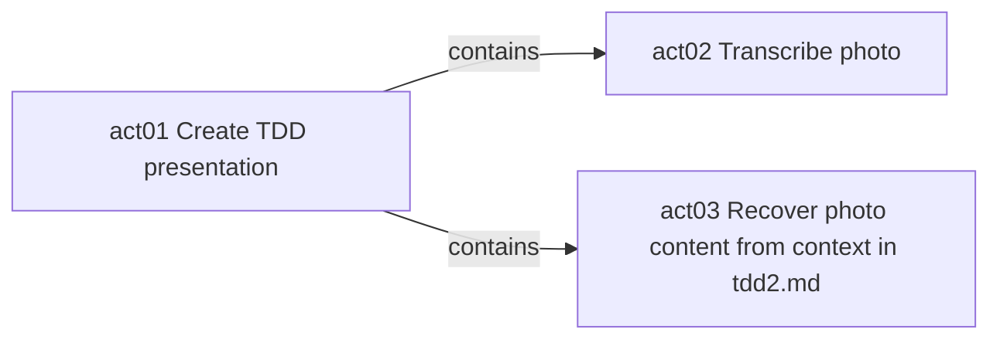

# Acts

- [ ] `act01` Create TDD presentation #contains/act01/act02 #contains/act01/act03 #status/open
  - [x] `act03` Recover photo content from context in tdd2.md #contains/act01/act03 #status/closed
  - [ ] `act02` Transcribe photo #contains/act01/act02 #status/open

## Authors
- actor01 Local/User #actor/actor01

## Events

### act01
- 2026-10-14T11:03:25+03 #actor/actor01 created title="Create TDD presentation"
- 2026-10-14T11:03:37+03 #actor/actor01 edge-added label="contains" to="act02"
- 2026-10-14T11:17:16+03 #actor/actor01 edge-added label="contains" to="act03"

### act02
- 2026-10-14T11:03:37+03 #actor/actor01 created title="Transcribe photo"
- 2026-10-14T11:03:37+03 #actor/actor01 moved parent="act01"
- 2026-10-14T11:08:53+03 #actor/actor01 started duration="PT1H" expires-unix="1791968933"
- 2026-10-14T11:17:31+03 #actor/actor01 stopped reason="Paused for contextual reconstruction requested by user"

### act03
- 2026-10-14T11:17:16+03 #actor/actor01 created title="Recover photo content from context in tdd2.md"
- 2026-10-14T11:17:16+03 #actor/actor01 moved parent="act01"
- 2026-10-14T11:17:31+03 #actor/actor01 started duration="PT1H" expires-unix="1791969451"
- 2026-10-14T12:46:24+03 #actor/actor01 closed reason="Created and verified tdd2.md with contextual reconstruction and no transcription annotations"

## Graph

| Relation | From | To |
| --- | --- | --- |
| `contains` | `act01` | `act02` |
| `contains` | `act01` | `act03` |

