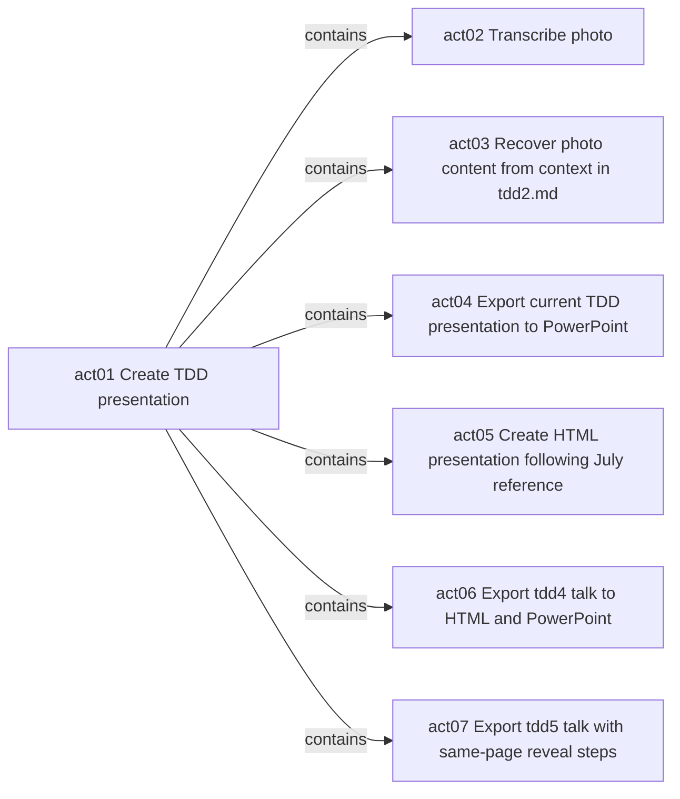

# Acts

- [ ] `act01` Create TDD presentation #contains/act01/act02 #contains/act01/act03 #contains/act01/act04 #contains/act01/act05 #status/open
  - [ ] `act07` Export tdd5 talk with same-page reveal steps #doing/actor01 #lease-start/1793179715 #lease-duration/PT4H #status/doing
  - [ ] `act06` Export tdd4 talk to HTML and PowerPoint #doing/actor01 #lease-start/1793171308 #lease-duration/PT2H #status/doing
  - [x] `act05` Create HTML presentation following July reference #contains/act01/act05 #status/closed
  - [x] `act04` Export current TDD presentation to PowerPoint #contains/act01/act04 #status/closed
  - [x] `act03` Recover photo content from context in tdd2.md #contains/act01/act03 #status/closed
  - [ ] `act02` Transcribe photo #contains/act01/act02 #status/open

## Authors
- actor01 Local/User #actor/actor01

## Events

### act01
- 2026-10-14T11:03:25+03 #actor/actor01 created title="Create TDD presentation"
- 2026-10-14T11:03:37+03 #actor/actor01 edge-added label="contains" to="act02"
- 2026-10-14T11:17:16+03 #actor/actor01 edge-added label="contains" to="act03"
- 2026-10-19T09:07:12+03 #actor/actor01 edge-added label="contains" to="act04"
- 2026-10-19T09:07:12+03 #actor/actor01 edge-added label="contains" to="act05"

### act02
- 2026-10-14T11:03:37+03 #actor/actor01 created title="Transcribe photo"
- 2026-10-14T11:03:37+03 #actor/actor01 moved parent="act01"
- 2026-10-14T11:08:53+03 #actor/actor01 started duration="PT1H" expires-unix="1791968933"
- 2026-10-14T11:17:31+03 #actor/actor01 stopped reason="Paused for contextual reconstruction requested by user"

### act03
- 2026-10-14T11:17:16+03 #actor/actor01 created title="Recover photo content from context in tdd2.md"
- 2026-10-14T11:17:16+03 #actor/actor01 moved parent="act01"
- 2026-10-14T11:17:31+03 #actor/actor01 started duration="PT1H" expires-unix="1791969451"
- 2026-10-14T12:46:24+03 #actor/actor01 closed reason="Created and verified tdd2.md with contextual reconstruction and no transcription annotations"

### act04
- 2026-10-19T09:07:12+03 #actor/actor01 created title="Export current TDD presentation to PowerPoint"
- 2026-10-19T09:07:12+03 #actor/actor01 moved parent="act01"
- 2026-10-19T09:08:18+03 #actor/actor01 started duration="PT1H" expires-unix="1792393698"
- 2026-10-20T15:16:37+03 #actor/actor01 closed reason="Exported and verified 32 editable PowerPoint slides with source notes, links and native unit diagram"

### act05
- 2026-10-19T09:07:12+03 #actor/actor01 created title="Create HTML presentation following July reference"
- 2026-10-19T09:07:12+03 #actor/actor01 moved parent="act01"
- 2026-10-20T15:16:37+03 #actor/actor01 started duration="PT1H" expires-unix="1792502197"
- 2026-10-20T15:22:06+03 #actor/actor01 closed reason="Created offline HTML following July deck and verified all 32 slides, desktop and mobile layout, keyboard and button navigation, links and diagram"

### act06
- 2026-10-28T09:08:28+02 #actor/actor01 started duration="PT2H" expires-unix="1793178508"

### act07
- 2026-10-28T11:25:57+02 #actor/actor01 created title="Export tdd5 talk with same-page reveal steps"
- 2026-10-28T11:25:57+02 #actor/actor01 moved parent="act01"
- 2026-10-28T11:28:35+02 #actor/actor01 started duration="PT4H" expires-unix="1793194115"

## Graph

| Relation | From | To |
| --- | --- | --- |
| `contains` | `act01` | `act02` |
| `contains` | `act01` | `act03` |
| `contains` | `act01` | `act04` |
| `contains` | `act01` | `act05` |
| `contains` | `act01` | `act06` |
| `contains` | `act01` | `act07` |

