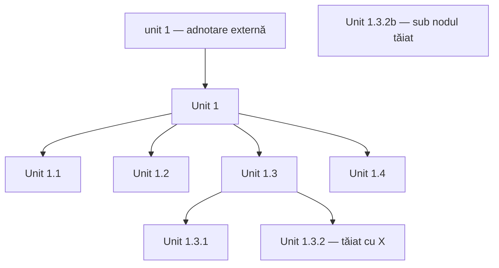

# TDD — Presentation

**Data de pe foaie:** 2026-10-07  
**Sursă:** [IMG_20261014_104947.jpg](IMG_20261014_104947.jpg)

> Transcrierea păstrează formulările în engleză din fotografie. Titlurile de secțiune organizează notițele, fără să adauge conținut prezentării. `[lectură incertă: …]` indică un pasaj a cărui citire nu este sigură; `[ilizibil]` indică text care nu poate fi recuperat fidel. Corecturile și relațiile grafice sunt consemnate separat.

## 1. Introduction

- Who am I
  - I've always tested.
  - Become ~~[ilizibil]~~ infected in 2000 [lectură incertă: „Kent”] XP.
  - Practices: TDD, Pom., … [lectură incertă pentru „TDD, Pom.”].
- [lectură incertă: „ADRAC”] — Test Automation.

În colțul din dreapta sus sunt trei chenare: **2026-10-07**, **TDD**, **Presentation**. O acoladă lângă „Who am I” și „Test Automation” le grupează cu cele trei notițe autobiografice.

## 2. The problem with Code → Tests

- The problem … with Code → Tests.
- Small changes throw away past manual testing.

O linie curbată pleacă din zona „The problem … with Code” către observația despre „small changes”. „Tests” se află la capătul săgeții din dreapta lui „with Code”.

## 3. The problem with Tests

- The problem with Tests → fragile / too many / coverage.
- [lectură incertă: „mocks”] excel at fragility.

Lângă acestea sunt două grupuri de notițe, despărțite prin linii verticale:

| Primul grup | Al doilea grup |
| --- | --- |
| tedious | take time |
| copy paste | need external deps |
| too complex ~~[ilizibil]~~ | not my [lectură incertă: „exact picture”] |
| (ifs [corectură ilizibilă]) | |

Pe rândul „too complex”, un cuvânt tăiat pare să fie „those” sau „close”; lectura nu este sigură.

## 4. But now we have AI

- But now we have AI → more code, [lectură incertă: „few bugs”], we fix ?! Really?
- Manual test anybody?
- The problem with AI's Code.
- The problem with AI Tests:
  - Regenerate code with [lectură incertă: „slight”] improvements.
  - Bad tests.

„AI” este adăugat deasupra liniei dintre „with” și „Code”. „Bad” este îngroșat/corectat cu cerneală albastră. În nota „regenerate code”, „with …” este scris mai mic, sub rândul principal.

## 5. Split problem: What is a UNIT?

- Split problem:
  - What is a UNIT?
- **A facade** to something that acts as a unit. A responsibility.
- Where do we cut?
- **Top down unit ⇒ Test Driven Design.**
- Split it when it breaks and when we reach [lectură incertă: „reach”; rândul se termină aici].
- We don't want to know the details ⇒ whatever works for the unit.

„What” are o corectură la început; întrebarea este subliniată. „A facade” și „Top down” sunt, de asemenea, subliniate. Un marcaj din stânga leagă întrebarea despre unitate de „Top down unit” și de principiile de mai jos.

## 6. Principles

- Encapsulation.
- Divide & conquer.
- YAGNI.
- Tell Don't Ask.

Cele patru principii pornesc dintr-un mănunchi de linii, în dreapta cuvântului „Principles”. În „Tell Don't Ask”, **Don't** este subliniat. Începutul cuvântului „Principles” este rescris cu cerneală albastră.

## 7. Unit diagram

Diagrama are un nod de intrare **Unit 1**, patru noduri pe nivelul următor și o descompunere suplimentară a lui **Unit 1.3**.

### Detaliile grafice ale diagramei

- Fiecare unitate este încadrată într-un chenar desenat de mână.
- Deasupra și în dreapta nodului-rădăcină este încă o etichetă „unit 1”, cu săgeată către chenarul **Unit 1**.
- Din **Unit 1** pleacă patru săgeți către **Unit 1.1**, **Unit 1.2**, **Unit 1.3**, **Unit 1.4**.
- Din **Unit 1.3** pleacă două săgeți către **Unit 1.3.1** și **Unit 1.3.2**.
- **Unit 1.3.2** este tăiat cu un X mare.
- Sub nodul tăiat este un alt chenar: **Unit 1.3.2b**. Poziționarea sugerează o înlocuire; nu se distinge o săgeată separată către acesta.
- Trei linii lungi delimitează vizual zonele dintre ramurile diagramei: între **1.1 / 1.2**, între **1.2 / 1.3**, și între subarborele **1.3 / 1.4**. Sunt delimitări, nu conexiuni suplimentare între noduri.
- O acoladă/linie lungă pe marginea stângă continuă gruparea principiilor și a diagramei către eticheta **emergent props**.

## 8. A good Unit test

În dreapta diagramei:

**A good Unit test.**  
**(with real db):**

- Minimal input info (≈ concepts) → no accidental complexity.
- Clear output.

„Input” este o inserție mică deasupra lui „info”. Semnul dinainte de „concepts” este suprascris și poate fi citit și ca `[lectură incertă: „5” sau „no”]`. „Good” este rescris/îngroșat cu cerneală albastră.

## 9. Emergent props

- Testable code, composable, instantiable, fast.
- Focus on FIRST problem.

Cele două rânduri sunt grupate cu o acoladă în dreapta lui „emergent props”. Între „code” și „composable” există o suprapunere/corectură. „FIRST” este îngroșat și parțial suprapus peste rândul inferior.

O săgeată spre dreapta continuă ideea:

> Opens doors for explorable code.  
> (clear errors ⇒ [lectură incertă: „guiding”])  
> ⇒ see git errors.

Ultimul cuvânt din paranteză ajunge la marginea din dreapta a fotografiei și nu poate fi citit complet cu certitudine. „Git” din ultimul rând este o lectură incertă.

## 10. Addendum

- Use assertj — in Java, Kotlin.
- Don't mock, stub, fake ⇒ Lazy Load / Inject Deps Manually.
- Facade to instantiate Unit.

„Addendum” este subliniat. „Deps” are o corectură/îngroșare cu cerneală albastră. „Lazy Load” și „Inject Deps Manually” sunt scrise pe două rânduri, în dreapta săgeții de după „fake”.

## 11. Concluding note

Într-un chenar mare, în partea de jos:

> **TRIM Down Info**

## Pasaje de confirmat din manuscris

Acestea sunt lecturile incerte păstrate mai sus, nu completări ale prezentării:

- Acronimul dinainte de „Test Automation”.
- Cuvântul tăiat după „Become”, numele/nota de după „2000” și lista „Practices”.
- „mocks excel at fragility” și corectura de după „too complex”, inclusiv paranteza „ifs …”.
- Finalul lui „not my … picture”.
- Expresia dintre „more code” și „we fix”.
- Inserția de după „regenerate code with”.
- Ultimul cuvânt al rândului „Split it when it breaks and when we …”.
- Semnul/cuvântul dinainte de „concepts”.
- Finalul parantezei „clear errors ⇒ …” și „git” din „see git errors”.
