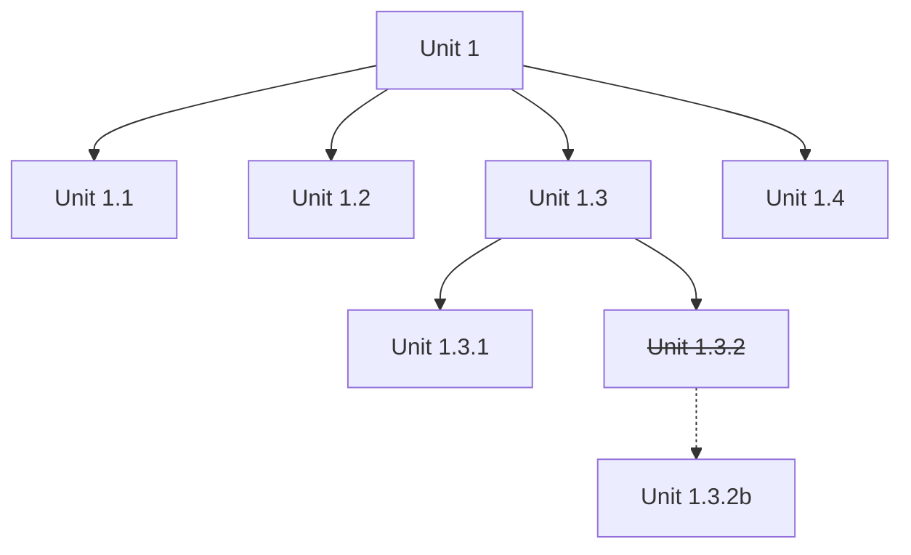

# TDD Presentation

2026-10-07

## Who am I?

- I've always tested.
- Became test-infected around 2000 through XP.
- Practices: TDD, Pomodoro, …
- Test automation.

## The problem with code

Code → Tests.

Small changes throw away past manual testing.

## The problem with tests

- Fragile.
- Too many.
- Coverage.

Mocks excel at fragility.

- Tedious.
- Copy-paste.
- Too complex: conditionals inside tests.
- Take time.
- Need external dependencies.
- Don't reflect my exact situation.

## But now we have AI

More code, fewer bugs, we fix them?! Really?

Manual testing, anybody?

## The problem with AI's code

## The problem with AI tests

- Regenerate code with slight improvements.
- Bad tests.

## Split the problem

### What is a unit?

A facade to something that acts as a unit. A responsibility.

### Where do we cut?

Top-down units ⇒ Test-Driven Design.

- Split it when it breaks and when we need to search through it.
- We don't want to know the details: whatever works for the unit.

## Principles

- Encapsulation.
- Divide and conquer.
- YAGNI.
- Tell, Don't Ask.

## Units

## A good unit test

With a real database:

- Minimal input information, expressed in concepts ⇒ no accidental complexity.
- Clear output.

## Emergent properties

- Testable code.
- Composable.
- Instantiable.
- Fast.
- Focus on the first problem.

Opens doors for explorable code.

Clear errors provide guidance. See Git errors.

## Addendum

- Use AssertJ in Java and Kotlin.
- Don't mock, stub, or fake ⇒ lazy-load and inject dependencies manually.
- Use a facade to instantiate the unit.

## Trim down information

**TRIM Down Info.**
