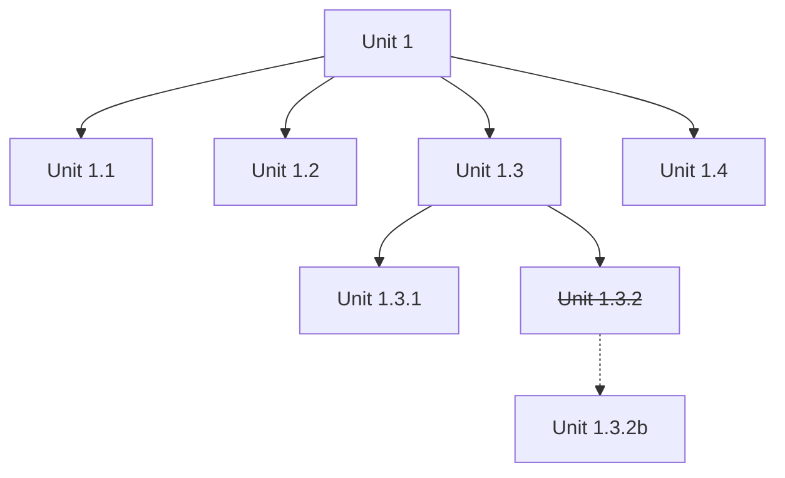

# TDD Talk Preparation
## TODO
1. Topics
2. Invitation
3. Presentation
4. Translate Romanian - not needed

Notes:
- Add stop-and-show at '+++'. Otherwise each section is a page

### Topics

- theory
- practice - code samples
- real experiences

### Invitation

<pre>
Hi all,

When do tests help us change code with confidence, and when do they become an obstacle?
What does **Test-Driven Development (TDD)** offer as a design and development practice? And what changes when AI agents write both the code and the tests?

I'd like to invite you to a session, and hopefully an open discussion, about TDD, drawing on practical experiences, both positive and constructive.

**We'll cover:**

1. What is TDD? The purpose of TDD and the RED > GREEN > REFACTOR cycle.

2. TDD in the Agentic Era: the role of tests and developers when working with AI agents.

3. TDD: The Good, the Bad and the Ugly: What works well and where things can go wrong at each stage of the cycle.

4. Beyond TDD: Testing Approaches and Trade-offs: Test-at-end, acceptance testing, BDD, internal testing, mocking libraries and UI testing, including their benefits, costs and potential pitfalls.

5. Practices That Complement TDD: XP, pair programming, trunk-based development, DDD, hexagonal architecture, clean code, and design principles such as DRY, OCP and SRP.

The goal is simple: how can we write tests with minimum effort while getting maximum value from them?

Questions and experiences from your own projects are very welcome, including those situations where tests may have caused more headaches than help.

At the end, we can also identify topics for future sessions based on real challenges and experiences from our projects.
</pre>

### Prepare

> Paste each question and its options as separate Teams messages, so people can react to their preferred answer.

To help tailor the TDD session, please react to one answer per question.

1. How much have you used TDD?
- Never tried it.
- Tried it, but rarely use it.
- Use it regularly.

2. When do you usually write automated tests?
- Before implementing the behavior.
- During or after implementation.
- Rarely write automated tests.

3. What is your biggest frustration with testing?
- Writing tests takes too much effort.
- Tests break when I change or refactor code.
- Tests pass, but bugs still reach production.

4. How do you use AI for development?
- I don't currently use it.
- For suggestions or generating code and tests.
- I delegate tasks to an agent that edits code and runs tests.

5. What would you most like from this session?
- Understand TDD through a practical example.
- Make tests simpler and easier to maintain.
- Explore TDD when working with AI agents.

6. Which language do you mainly use?
- Java / Kotlin / Scala
- JavaScript / TypeScript
- Other - please reply with the language.

7. Which testing libraries or frameworks do you use?
- junit
- mockito
- assertj
- playwright, cucumber
- ...

# TDD Talk

## Content

TDD Talk
2026-10-28
Costin Grigore
DB Engineering Coach

+++
Test Infected 2001 through XP.
Test Infected = I need tests to clarify when is done: the bug, the feature.

## Summary
1. What is TDD? RED > GREEN > REFACTOR cycle
2. TDD in the Agentic Era
3. TDD The Good, the Bad and the Ugly
4. Beyond TDD
5. Complementing Practices
6. Questions, experiences, next sessions
7. Resources


## 1. What is TDD? The purpose of TDD and the RED > GREEN > REFACTOR cycle.

### 1.1 Why tests? Do we need them?

- Code -> Tests
  - scafolding to help out
  - quality
  - acceptance
  - post change tests
- There are many ways to pair code with tests

+++

- Human
  - Code
    - On every change we throw away past manual testing.
  - Tests
    - Fragile.
    - Tests are tightly coupled to the implementation.
    - Too many.
    - Coverage. Proper coverage?
    - Tedious.
    - Copy-paste: breaks DRY (Don't Repeat Yourself).
    - Too complex: conditionals inside tests.
    - Take time.
    - Need external dependencies.
- AI
  - Code
    - More code.
    - Better quality?
    - Bugs fixed through regeneration.
      - Prompt is the new spec. Is it better?
    - Manual testing?
    - No test if it is regenerated?
  - Tests
    - No abstraction.
    - Deleting/changing regression tests just to pass.
    - Reflection-based tests to circumvent private methods.

### 1.2 Were did all started?

- Agile movement
- Test-driven development : by example : Beck, Kent 2002
  - https://archive.org/details/est-driven-development-by-example/test-driven-development-by-example/
- Still works now, also with AI
- Part of eXtreme Programming practices:
  

### 1.3 TDD Cycle: RED-GREEN-REFACTOR

TDD is practice - https://newsletter.kentbeck.com/p/canon-tdd


RED - Write a test, make it compile, run to confirm it fails.
  - There are tests that always pass. We want to be sure we first fail (including compilation errors).

GREEN - Write the simplest code to make the test pass.
  - Sins allowed: hacks, duct tape programming, copy-paste, and other shortcuts are allowed.
  - YAGNI. Don't overengineer. No analysis paralysis.

REFACTOR - Refactor the code to remove duplication.
  - Keep the test green.
  - Respect: YAGNI, OCP, and other principles, no code smells, and other good practices.

+++

Different phases have different purposes/focus:
- RED: prove missing functionality without knowing/passing implementation details
- GREEN: add new functionality as fast as possible (hacking around, duplicate code, whatever works to fix)
- REFACTOR: clean up the solution (good practices, remove code smells, clean code, clean design)

### 1.4 A sample

Requirement:
> Given a company group(division, organization, department), show its direct child groups and the number of projects directly contained in each child group.

```java
@Test
void showsChildGroupsWithTheirDirectProjectCounts() {
    //var directory = ProjectDirectory.of(); //1
    var directory = ProjectDirectory.of("uat-datasource1"); //2

    try {
        directory.createGroup("Technology");
        directory.createGroup("Engineering", "Technology");
        directory.createGroup("Finance", "Technology");

        directory.addProject("Engineering", "Atlas");
        directory.addProject("Engineering", "Orion");
        directory.addProject("Finance", "Ledger");

        assertThat(directory.childGroupsOf("Technology"))
            .containsExactlyInAnyOrder(
                GroupSummary.of("Engineering", 2),
                GroupSummary.of("Finance", 1)
            );
    } finally {
        // Cleanup //3
        directory.deleteGroupRecursively("Technology");
    }
}
```

### 1.5 What is the unit from unit testing ?

A good/canon TDD
- design tool
- grows a regression test suite
- feel safe to refactor (enables YAGNI and OCP) - refactoring is first class concept

More on what is a **unit**
- https://blog.stevensanderson.com/2009/08/24/writing-great-unit-tests-best-and-worst-practises/

A facade to something that acts as a unit. A responsibility.

### 1.6 Where do we cut?

Top-down units ⇒ Test-Driven Design.

- Split it when it breaks and when we need to search through it.
- We don't want to know the details: whatever works for the unit.



#### Spawning a unit test

So we have a test that fails.
We might want to expose an internal detail of the unit and make assertions on it. Is thightly coupled to the implementation internal details. If that sub-unit component is complex or is used in other parts of the system it can become a unit on its own. If is simple the current test should be enough definition of success.

Principles

- Encapsulation
- Divide and conquer
- YAGNI
- Tell, Don't Ask

#### Entrypoint to unit

Test in TDD is **developer test**.
The unit is the thing that has a facade.
With a test we want to exercise the behavior of the system. 

Some classes are implementation details of the unit and some advocate to delete tests used for the internal implementation.

The facade/API has usually 4 types of operations that act in concert:
- factory/lookup - to get access to a unit
- functions - compute something
- query - to observe the state
- commands - to change the state

Usually our tests need first to get access to a unit, then to query it, and finally to command it.

So naturally we will grow the tests on the most complex parts of the unit.

### 1.7 Anathomy of a good unit test

1. Get access to the unit.
2. Move the unit to a known state
   - Should not depend on past runs (the test before could even crash so the cleanup before is not guaranteed to be executed).
3. Query the unit to assert the state is as expected.
4. Command the unit to change its state.
5. Query the unit to assert the state is as expected.
6. ~~Cleanup the unit to a known state.~~
   - Cleanup is not warranted (the system could crash, or end in the middle of the test).
   - Cleanup would create the impression that the other tests are safe to run after this one and that they don't need to be isolated. But they do.
   - Cleanup will block investigations of the state of the unit after a test has run.


```java
@Test
void showsChildGroupsWithTheirDirectProjectCounts() {
    var directory = ProjectDirectory.of("uat-datasource1");

    // Establish a known initial state, even if a previous run crashed.
    directory.deleteGroupRecursively("Technology");
    directory.createGroup("Technology");

    assertThat(directory.childGroupsOf("Technology")).isEmpty();

    directory.createGroup("Engineering", "Technology");
    directory.createGroup("Finance", "Technology");

    directory.addProject("Engineering", "Atlas");
    directory.addProject("Engineering", "Orion");
    directory.addProject("Finance", "Ledger");

    assertThat(directory.childGroupsOf("Technology"))
        .containsExactlyInAnyOrder(
            GroupSummary.of("Engineering", 2),
            GroupSummary.of("Finance", 1)
        );
}
```

`deleteGroupRecursively` should tolerate a missing group. This assumes `"Technology"` is reserved for this test and concurrent runs do not share it.

+++

With a real database:

- Minimal input information, expressed in concepts ⇒ no accidental complexity.
- Clear output.

Emergent properties

- Testable code.
- Composable.
- Instantiable.
- Fast.
- Focus on the first problem.

Opens doors for explorable code.

Clear errors provide guidance. See Git errors.

+++ 

- Use AssertJ in Java and Kotlin.
- Better than mock, stub, or fake ⇒ lazy-load real database
- Prefer constructor injection - works with dependency injection containers but also manuall (even without annotations).
  - Forces better design in wiriging.
- Use a facade to instantiate the unit.

## 2. TDD in the Agentic Era

> The role of tests and developers when working with AI agents.

## 3. TDD The Good, the Bad and the Ugly

> What works well and where things can go wrong at each stage of the cycle.

#### Things that are exposed as bad practices by TDD

- testing implementation details
- mocking
- testing query and command separately
- changing internal state via methods that are not part of the facade (is a white-box testing smell)
- tests that are not isolated and depend on the order of execution of other tests (is a white-box testing smell)

## 4. Beyond TDD

> Testing Approaches and Trade-offs: Test-at-end, acceptance testing, BDD, internal testing, mocking libraries and UI testing, including their benefits, costs and potential pitfalls.

#### Testign Myths

- We have a battery of tests and on mutation we can pinpoint the mutation by just looking at the tests. With what price? In writing tests and in maintaining them?
- Test coverage will help. Maybe if 100%, and maybe if we also have 100% branch coverage. That is not practical and rarely achievable. So we need strategic testing. Top down?

## 5. Complementing Practices
> XP, pair programming, trunk-based development, DDD, hexagonal architecture, clean code, and design principles such as DRY, OCP and SRP.

#### Things that go well with TDD

- DDD (Domain Driven Design) & Hexagonal Architecture.
  - we could use a persistance layer (whatever is faster to run and use)
    - database: embedded, in memory or a real one
      - real SQL queries/CRUD also get tested (think that native sql querries)
    - in memory data structures
- Clean Code
- Refactoring of Code Smells
  - Open Closed Principle. If we break tests then we don't respect the OCP.
  - A refactor keeps the tests green.
  - We are free to change the implementation details if the tests are green.


## 6. Questions, experiences, next sessions
> Questions and experiences from your own projects are very welcome, including those situations where tests may have caused more headaches than help.
> Topics for future sessions based on real challenges and experiences from our projects.

## 7. Resources

- https://www.google.com/search?q=TDD%2C+Where+Did+It+All+Go+Wrong&sourceid=chrome&ie=UTF-8&source=chrome.ctxt
- TDD, Where Did It All Go Wrong (Ian Cooper) - https://www.youtube.com/watch?v=EZ05e7EMOLM
- https://www.reddit.com/r/programming/comments/21fhy7/ian_cooper_tdd_where_did_it_all_go_wrong/
- https://archive.org/details/est-driven-development-by-example/test-driven-development-by-example/
- Dan North - https://dannorth.net/
- https://martinfowler.com/articles/are-harnesses-worth-the-cost.html
